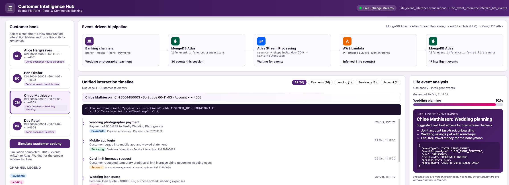
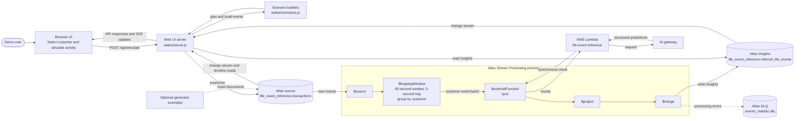

# Life-Event Inference

### Real-time customer event inference

A banking demo that simulates customer activity in the web UI and writes each
event to MongoDB. Atlas Stream Processing (ASP) listens to the source collection's
change stream, groups each customer's events into overlapping 60-second windows
every 5 seconds (for demo purposes), and calls AWS Lambda to infer possible life events. ASP keeps
this path continuously event-driven, so new activity can be analyzed and returned
to the UI without waiting for a scheduled batch job or polling cycle. It also
coordinates windowing, Lambda enrichment, and writing results to the insights
collection as events flow through the system. The UI displays both the incoming
transactions and inferred events. Predictions are hypotheses, not confirmed
customer facts.

## Interface



## Data Flow



## Project Layout

| Path | Purpose |
| --- | --- |
| [.env.example](.env.example) | Shared environment settings with blank credentials. |
| [config.js](config.js) | Native `.env` loading and runtime configuration validation. |
| [generators/batch-events.js](generators/batch-events.js) | Optional bulk event-generation example. |
| [generators/stream-events.js](generators/stream-events.js) | Optional standalone narrative-generation example. |
| [processors/life_event_inference.json](processors/life_event_inference.json) | ASP processor template; render before importing. |
| [scripts/render-processor.js](scripts/render-processor.js) | Builds a credential-free processor from environment settings. |
| [lambda/index.mjs](lambda/index.mjs) | Lambda handler that calls the AI gateway. |
| [samples/event.json](samples/event.json) | Example source document. |
| [webui/server.js](webui/server.js) | HTTP server, MongoDB access, simulations, and server-sent events. |
| [webui/scenarios.js](webui/scenarios.js) | Customer scenarios and event builders used by the UI. |
| [webui/public/](webui/public/) | Browser HTML, JavaScript, and styles. |
| [tests/config.test.js](tests/config.test.js) | Offline environment-loading, runtime, and renderer tests. |

The web UI, processor renderer, and tests use the root package and lockfile. The
standalone generators are optional examples, not part of the normal demo workflow.
The Lambda handler is an independent ES module; it does not need the demo's
MongoDB dependency.

## Setup

Use a Node.js version supported by the installed MongoDB driver (20.19 or later
for MongoDB driver 7). From the repository root:

```sh
cd demo/life_event_inference
npm ci
```

Configure the project-root `.env`. A local file is provided; for a fresh clone,
create one from the example without overwriting existing settings:

```sh
cp -n .env.example .env
```

Replace the `MONGODB_URI` placeholder using your normal secret-management
workflow. Set `AI_GATEWAY_API_KEY` and `AI_GATEWAY_URL` for local Lambda execution;
the example leaves the API key and gateway URL blank. `.env` and its local
variants are ignored by Git; do not commit or package them. No new dependency is
required to load them.

The server, processor renderer, and local Lambda load the project-root `.env`
relative to their file locations. The optional generators do too. Existing shell
variables take precedence, even when empty. The `.command` launcher uses the same
configuration. Each component validates only the settings it needs, so rendering
does not require credentials.

Values are literal: `${OTHER_VARIABLE}` expansion inside `.env` is not supported.
Set related database names explicitly. Restart a running process after editing
its configuration.

### Environment Settings

The values below are supplied by `.env.example`, not hidden application defaults.

| Variable | Example Value | Used By |
| --- | --- | --- |
| `MONGODB_URI` | `mongodb+srv://.../`; replace placeholder | Web UI server; optional generators |
| `DB_NAME` | `life_event_inference` | Web UI server, ASP source; optional generators |
| `COLLECTION_NAME` | `transactions` | Web UI server, ASP source; optional generators |
| `INSIGHTS_DB` | `life_event_inference` | Server, ASP output |
| `INSIGHTS_COLLECTION` | `inferred_life_events` | Server, ASP output |
| `EVENT_COUNT` | `100000` | Optional batch example; positive integer |
| `PORT` | `3000` | Server; integer from 1 to 65535 |
| `AI_GATEWAY_API_KEY` | Blank; required credential | Lambda |
| `AI_GATEWAY_URL` | Blank; set your gateway responses endpoint | Lambda |
| `AI_GATEWAY_MODEL` | `gpt-5.2` | Lambda |
| `ASP_PROCESSOR_NAME` | `life_event_inference` | ASP renderer |
| `ASP_ATLAS_CONNECTION` | `atlas` | ASP source, output, and DLQ |
| `ASP_LAMBDA_CONNECTION` | `lambda` | ASP external function |
| `ASP_LAMBDA_FUNCTION` | `lambda` | ASP external function |
| `ASP_TIER` | `SP10` | ASP renderer; confirm availability in Atlas |
| `ASP_DLQ_DB` | `events_realistic` | ASP dead-letter output |
| `ASP_DLQ_COLLECTION` | `dlq` | ASP dead-letter output |
| `ASP_WINDOW_SECONDS` | `60` | ASP hopping window |
| `ASP_HOP_SECONDS` | `5` | ASP hopping window; must not exceed window size |
| `ASP_PARALLELISM` | `8` | ASP external function |

The browser cannot read `.env`. It receives only the explicitly public settings
already returned by `/api/config`, never the MongoDB URI or gateway credentials.

The Atlas deployment must support change streams. The local MongoDB user needs
appropriate access to read/watch the event and insight collections and insert
generated events.

## Configure the Processing Path

The data-flow diagram above shows how the UI-generated documents move through
ASP and Lambda, then return to the UI as inferred events. The processor reads
new inserts from the configured source collection and merges predictions into
the configured insights collection.

1. Deploy [lambda/index.mjs](lambda/index.mjs) to AWS Lambda. Package the contents
   of `lambda/` so `index.mjs` is at the deployment root, and set the handler to
   `index.handler`. Use Node.js 20.19 or later with built-in `fetch` and
   `process.loadEnvFile`. Do not upload `.env` or the whole demo directory.
2. Set `AI_GATEWAY_API_KEY`, `AI_GATEWAY_URL`, and `AI_GATEWAY_MODEL` in the AWS
   Lambda environment using your existing console or infrastructure workflow.
   Local `.env` values are not automatically transferred to AWS. The Lambda needs
   network access to the configured endpoint and remains standalone without a
   local `.env` file.
3. Configure ASP connections matching `ASP_ATLAS_CONNECTION` and
   `ASP_LAMBDA_CONNECTION`, and ensure ASP can invoke `ASP_LAMBDA_FUNCTION`.
4. Run `npm run render:processor`. This reads the JSON template and writes
   `processors/generated/life_event_inference.json`, with concrete settings
   and correctly typed numeric values. Review and import that generated file,
   not the template. Generated output is ignored by Git and contains no
   credentials. The renderer checks configuration shape; Atlas still validates
   service limits, available tiers, and connections.
5. Create and start the rendered processor using your existing ASP deployment
   workflow. Rerender after configuration changes. Neither editing `.env` nor
   rendering a file updates deployed processors or Lambda settings automatically.

The sample settings group customer activity in a 60-second hopping window with a
5-second hop and invoke the Lambda for each customer window. The flattening
example is a separate reference stage, not a deployment step or required change
to the source schema.

## Run the Demo

From the project directory, with the environment configured:

```sh
npm start
```

Open `http://localhost:3000`, select a customer, and click **Simulate customer
activity**. The UI inserts that customer's event documents into the configured
`DB_NAME.COLLECTION_NAME` collection; change streams update the activity view and
the ASP processor consumes the inserted events. Set `PORT` to use another port.

## Optional Generator Examples

The scripts under `generators/` are standalone examples, not needed to run the
demo. They write directly to the same configured MongoDB collection, so running
one alongside the UI can mix its documents with the UI simulation's data.

To try the narrative example from the project directory:

```sh
node generators/stream-events.js
```

For a small bulk-example run, `EVENT_COUNT` can be overridden in the shell:

```sh
EVENT_COUNT=20 node generators/batch-events.js
```

Both examples use the `.env` MongoDB target; review `DB_NAME` and
`COLLECTION_NAME` before running them. The batch data has different scenarios
from the UI's customer activity and may not produce the same inference results.

## Validation

Tests, rendering, syntax, and data-file checks do not access MongoDB or the AI
gateway. Lambda requests in tests are mocked:

```sh
npm test
npm run render:processor
node --check config.js
node --check scripts/render-processor.js
node --check lambda/index.mjs
node --check webui/server.js
node --check webui/scenarios.js
node -e 'const fs = require("node:fs"); for (const file of ["processors/generated/life_event_inference.json", "samples/event.json"]) JSON.parse(fs.readFileSync(file, "utf8"));'
```

Live end-to-end validation still requires configured Atlas, ASP, Lambda, and
gateway access. The offline checks do not deploy or modify cloud resources.